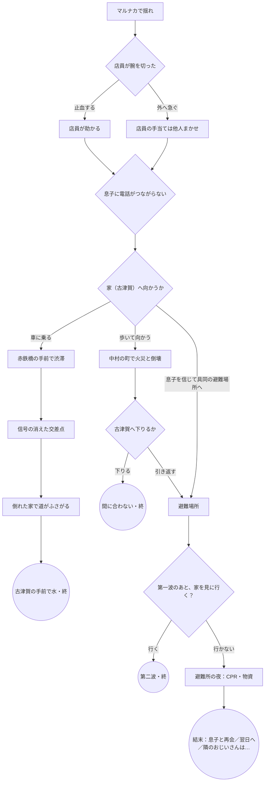

# この美しいまちに住む、あなたへ ―南海トラフ地震
## 設計案 v0.2（実在の場所で作り直した版）

> 四万十市の人たちへ。南海トラフ巨大地震と津波から生き延びる、選択肢で進む物語ゲーム。
> 救急対応ストーリーゲーム「その瞬間、あなたは」と同じ仕組み・同じ見た目のシリーズ作品。
> **【要確認】** は、地元の方や公表資料で確かめていただきたい所です。

---

## 0. 決まったこと

| # | 項目 | 決定 |
|---|---|---|
| 題 | 作品名 | **この美しいまちに住む、あなたへ ―南海トラフ地震** |
| Q1 | 地震が起きる日時 | 10月の平日、午前10時40分 |
| 場所 | 架空の場所 | **使わない。地区・学校・公園・店・病院・避難場所は実在名**。人物は架空 |
| 少女 | 場所 | 黒潮町入野の **SUNLIFE COFFEE WAVES.**（作者がお店に一言了解をもらう） |
| サーファー | 場所 | **入野の浜**（少女と同じ浜で交差） |
| 実習生 | 国籍・職場 | **フィリピン出身。下田の水産加工場**（会社名は出さない） |
| 実習生 | 名前 | 在留カードの名前は **マリア・ルス・サントス**。本人の名乗りは **ルイス**（ミドルネームの「ルス Luz」の男性形。自分の名前から選んだ名前） |
| 先生 | 学校 | **下田小学校**（浸水3〜5m、約18分で30cm） |
| 主婦 | 家 | **古津賀**（30〜60分、1〜5m）。具同のマルナカから赤鉄橋を渡って帰る道。番地は出さない |
| 外来患者 | 家 | **古津賀**。主婦の家の隣 |
| 病院 | 物語の中心 | 浸水域の外なので、停電・エレベーター停止・酸素・押し寄せるけが人と人手不足 |
| Q6 | 防災無線 | 標準語。反響と雑音で途切れる。聞き返し電話 **0880-34-7800** も実在の仕組みとして使う |
| Q8 | 入院患者 | 1946年（昭和南海地震の年）生まれ、80歳 |
| Q10 | 置き場所 | `tsunami/index.html`（1つのHTMLファイル） |

### 表示する断り書き
- タイトル画面：「この物語に出てくる人物と出来事は架空です。場所は実在しますが、学校・病院・お店・消防団の実際の避難計画や対応とは関係ありません。津波の想定は高知県・四万十市の公表資料（2025年度）をもとにしています」
- 下田小学校・市民病院・SUNLIFE COFFEE WAVES. の物語の冒頭にも、短く同じ断り書きを出す

---

## 1. 世界の設定

### 1-1. 3つの舞台

8人は3つの場所に分かれる。場所ごとに「主な敵」が違うので、8本を遊ぶ意味が出る。

| 舞台 | 主人公 | 主な敵 | 公表値（§10） |
|---|---|---|---|
| **入野の浜**（黒潮町） | 1 少女、2 サーファー | **時間**。海岸線は5分未満から | 浸水5〜15m |
| **下田**（四万十川の河口） | 3 マリア、4 先生、6 消防団員 | **時間＋言葉＋役目**。約18分 | 港沿い5〜10m、集落3〜5m |
| **中村・具同・古津賀** | 5 主婦、7 外来患者、8 入院患者 | **揺れ・倒壊・火災**。そして「家に帰る」こと | 中村・具同は浸水域の外。古津賀は30〜60分で1〜5m |

中村の物語では、「ここは浸水しない想定」が安心にも罠にもなる。安全な場所にいるのに、家族のいる古津賀（低い所）へ向かうと危険に入っていく。昭和南海地震で中村の町を壊したのは、津波ではなく揺れと火災だった。

### 1-2. 共通の時間の流れ（画面の時計は「地震発生から 0:12」のように出す）

| 経過 | 起きること |
|---|---|
| 0:00〜0:03 | 長い揺れ（約3分） |
| 0:03ごろ | 大津波警報。防災無線・携帯の警報 |
| 0:03〜0:15 | 中村で倒壊・火災・けが人・停電。電話がつながらない |
| 〜0:05 | 入野の海岸線に津波が来始める |
| 0:15〜0:20 | 平野・下田に30cmの津波（市のマップでは下田18分・平野15分） |
| 0:30〜0:60 | 竹島・八束・古津賀へ、川を遡って広がる |
| 1:00〜3:00 | 第二波・第三波 |
| 夜 | 避難所の夜（旧下田中学校、幡多農業高校など） |
| 翌日以降 | 避難所の暮らし。臨時情報、車中泊、関連死の危険 |

画面には津波到達までの残り時間を出さない。

### 1-3. 実在の場所（作中に出すもの）

- **入野**：SUNLIFE COFFEE WAVES.、入野の浜、入野松原、土佐西南大規模公園（大方地区）、土佐入野駅、**土佐西南大規模公園展望台津波避難タワー**（入野172-6付近、ふるさと総合センターの横、450人。2018年の香川大学の調査による【現在の状況は要確認】）
- **下田**：下田小学校、下田港、県道下田港線、有隣公園（標高28.5m）、下田中学校（旧、30.6m・指定避難所）、光明寺・秋葉神社・南宗寺・和霊神社、旧中医学研究所（41.3m）、とまろっと、四万十いやしの里、下田分団下田屯所（標高2.8m）、竹島川、四万十川
- **中村・具同・古津賀**：マルナカ（具同）、赤鉄橋（四万十川橋）、天神橋の商店街あたり、四万十市立市民病院（中村東町）、中村中学校、古津賀、幡多農業高校・中村特別支援学校（古津賀の避難場所）、為松公園、後川、具同小学校、中村西中学校

---

## 2. 難易度と根拠

| 主人公 | 場所 | 30cm到達 | 浸水深 | 高台まで | 難しさの理由 | 難易度 |
|---|---|---|---|---|---|---|
| 2 サーファー | 入野の沖 | 海岸線5分未満〜 | 5〜15m | 浜から陸へ、さらに高台へ | 海の上では揺れが分かりにくい。一番早い | ★★★★★ |
| 6 消防団員 | 下田の屯所→水門 | 約18分 | 5〜10m | 屯所そのものが標高2.8m。**海の方へ向かう役目** | 役目と命 | ★★★★★ |
| 1 少女 | 入野のカフェ | 5分未満〜 | 5〜15m | 土地勘ゼロ | 方言が分からない。周りに大人はいる | ★★★★☆ |
| 3 マリア | 下田の加工場 | 約18分 | 3〜10m | 有隣公園・光明寺など、数百m | 日本語が分からない | ★★★★☆ |
| 4 先生 | 下田小学校 | 約18分 | 3〜5m | 有隣公園まで数百m【要確認：子どもの足で何分か】 | すぐ動けば間に合う。**待つと間に合わない**。数十人を預かる | ★★★★☆ |
| 5 主婦 | 具同のマルナカ | （その場は浸水域の外） | ― | ― | 自分は安全。**家（古津賀）へ向かうと危険に入る** | ★★★☆☆ |
| 8 入院患者 | 市民病院 | （浸水域の外） | ― | ― | 自力で動けない。停電、人手不足、関連死 | ★★★☆☆ |
| 7 外来患者 | 市民病院 | （浸水域の外） | ― | ― | 残れば安全。**古津賀の家へ帰ろうとすると★★★★** | ★★☆☆☆ |

メニューには★と一言（例：「海の上。津波が一番早い」「その場は安全。でも家族は低い所にいる」）を出す。

---

## 3. 8人のあらすじと、悩む選択肢

共通：1本は **選択8〜10回・10〜15分**。選択肢は「正解・まあまあ・まずい・その場で終わる」の4種類。どれにも筋の通った理由をつけ、正解が一目で分からない書き方にする。

---

### 1. 少女　**七海（10歳）** ― 入野　「ことばの分からない浜で」
県外からの家族旅行。SUNLIFE COFFEE WAVES. で、父は浜へ写真を撮りに、母と弟はトイレへ。七海は一人で飲み物を待っている。

**あらすじ**：揺れの間、テーブルの下へ。店の人が叫んでいるが、幡多弁で半分しか分からない（「はよう〇〇〇〇へ〇〇〇けん！」）。無線は反響して聞き取れない。家族を探したい。知らない大人が手を引こうとする。浜から上がってきたサーファー（2）に出会う。高台で家族と会えるかどうかは、家族が「はぐれたら高い所で会う」と決めていたか（序盤の会話）と、七海の選択で変わる。

**悩む選択肢**
1. 揺れの後：**母のいるトイレへ走る** ／ その場で待つ（「動いたら会えなくなる」）／ 店の人について行く
2. 知らない大人が「〇〇〇、おいで！」：**ついて行く** ／ 「知らない人について行かない」を守る ／ 名前を聞いてから
3. 無線の「…ナミ…ケイホウ…タカイ…」：「ナミ」を自分の名前（七海）と聞き違えて **放送の聞こえる方へ** 向かう（誤解の選択肢）／ 「タカイ」だけを信じて上へ
4. 浜の方に父の姿が見えた気がする：**浜へ走る** ／ 大声で呼ぶだけにして、自分は上へ
5. 高台で家族がいない：**探しに下りる** ／ 待つ ／ 大人に名前と母の電話番号を伝える

**教訓**：稲むらの火、奥尻（数分で来る）、東日本（子どもが自分で高台へ、てんでんこ）

---

### 2. サーファー　**大地（20歳）** ― 入野　「海の上では揺れない」
入野の沖で波を待っている。海の上では揺れがよく分からない。浜の様子がおかしい。

**悩む選択肢**
1. 沖で：**いい波を待って様子を見る** ／ すぐ戻る ／ 沖へ出る（「沖の方が安全」と聞いたことがある。ボードでは無理＝誤解）
2. 浜で：**ボードを車に積む** ／ 全部置いて走る
3. **車で逃げる（一番速いはず）** ／ 走る（浜沿いの道はすぐ渋滞する）
4. 浜の知らない人たち：**一人ずつ声をかける（時間がかかる）** ／ 大声で一度叫んで自分は走る ／ 自分のことで精一杯
5. カフェの前で泣いている女の子（1）：**手を引いて連れて行く** ／ 近くの大人に任せる
6. 写真を撮っている男性（＝七海の父）：**腕をつかんで引っぱる** ／ 声だけかける
7. 高台で、第一波が小さかった：**車を取りに戻る** ／ 戻らない

**教訓**：奥尻、稲むらの火、東日本（車での避難、第一波の後に戻る）、能登（到達の早さ）

---

### 3. 技能実習生　**ルイス（30歳）** ― 下田　二部構成「にげる」「ひなんじょ」
**フィリピン出身。下田の水産加工場で3年目。** 在留カードの名前は **マリア・ルス・サントス**。出生時の性別は女性、心は男性で、自分では「ルイス」と名乗っている。日本語は「はい」「すみません」「だいじょうぶ」くらい。幡多弁はさらに分からない。**英語とタガログ語は話せる**。寮の部屋には在留カードとパスポート、家族の写真。

**表現の方針**
- 周りの台詞は、ルイスに聞こえる通りに出す：「〇〇〇〇〇〇！ 〇〇、〇〇〇〇〇！」。聞き取れた単語だけが残る（「つなみ」「にげ」「やま」）。物語の中で単語を覚えると、その後の台詞で見える文字が増える
- **英語は読める**。避難場所の看板の「Tsunami Evacuation Area」は分かる。でも周りの日本人には英語が通じない、という現実の分からなさ
- ルイスの心の声はふつうの日本語で書く（遊ぶ人はルイスの考えは分かるが、周りの言葉は分からない）
- 笑いの対象にも、かわいそうな人にもしない。自分で判断し、選び、助けも求める人として描く

**第一部「にげる」**：揺れで加工場のラインが止まる。先輩たちが叫んで走り出す。同じ寮のフィリピン人の後輩（女性）が泣いている。寮はすぐ近く。

1. **寮へ在留カードとパスポートを取りに戻る**（なくすと国に帰れない、と思い込んでいる）／ 取りに行かない
2. 先輩が手招きして何か叫ぶ：**ついて行く** ／ 後輩を探してから ／ 英語で聞き返す（通じない）
3. 行き先：近くの下田小学校の校舎（上の階）／ **有隣公園** ／ 看板の英語を頼りに別の道へ
4. 途中で道に座り込むおばあさん：**背負う** ／ 人を呼ぶ ／ 先に行く
5. 高台で、第一波の後：**寮へ戻る** ／ 戻らない

**第二部「ひなんじょ」（その夜〜翌日、旧下田中学校の体育館）**：先生（4）と下田小の子どもたちも、ここにいる。先生は運営を手伝っている。

1. 名簿：在留カード通り「マリア・ルス・サントス」「女」と書く ／ **「ルイス」とだけ書き、性別を空ける** ／ 書かずに外にいる
2. 「マリア・サントスさーん」と大声で呼ばれる：**返事をする** ／ しない ／ あとで受付の人にだけ、翻訳アプリで「ルイスと呼んでほしい」と伝える
3. トイレ：女性用の列 ／ 男性用の列 ／ **誰もいない時間まで我慢する**（水を飲まなくなる → 脱水・エコノミークラス症候群）／ 多目的トイレがあるか聞く
4. 寝る場所：「女性・子どもスペース」に案内される。**従う** ／ 入口近くで一人で寝る ／ 運営の人に相談する
5. 物資：生理用品を手渡される。必要なのは確かだが、人前で受け取るのはつらい。**受け取らない** ／ 受け取る ／ 人目のない所で取れるか聞く
6. 夜、隣の家族の子どもが熱を出す。ルイスは母国で看護助手をしていた（設定案）：**手伝いを申し出る** ／ 黙っている

**教訓**：東日本（第一波の後に戻る、避難所での女性・性的少数者への配慮不足）、能登（避難所のトイレ）、熊本（関連死）、外国人への「やさしい日本語」

---

### 4. 小学校の先生　**岡村先生（40歳）** ― 下田　「校庭の1分」
**下田小学校で授業中。** 学校は浸水3〜5mの区域の中。約18分で30cmの津波。有隣公園と旧下田中学校は数百m先の高台。

**あらすじ**：揺れの間、机の下へ。窓ガラスが割れる。揺れの後、校庭へ集まって点呼。「指示があるまで待機」という声。迎えに来た保護者が「うちの子を連れて帰る」。ある子が「先生、こっちの方が高いよ、お兄ちゃんが言いよった」。高台に着いてからも、さらに上へ行くか。消防団員（6）が通りから「はよう上がれ！」と叫ぶ。夜は旧下田中学校の避難所で運営を手伝い、ルイス（3）と出会う。

**悩む選択肢**
1. 揺れの後：**教室で全員の安全を確かめる** ／ すぐ校庭へ（割れたガラス）／ 階段で転んで足をくじいた子がいる（**骨折の固定**）
2. 校庭で「指示を待て」：**待つ** ／ 自分のクラスだけでも高台へ ／ 説得して全校で動く（時間がかかる）
3. 保護者が迎えに来た：**引き渡す**（保護者の家は浸水域の中）／ 「一緒に高台へ」と誘う ／ 渡さない（保護者は怒る）
4. 「こっちの方が高いよ」：**子どもの声を信じて道を変える** ／ 決めていた道を行く（倒れたブロック塀でふさがっている）
5. 有隣公園に着いた：**ここで止まる** ／ さらに上（旧下田中学校）へ
6. （夜・避難所の運営）名簿の性別欄を必須にするか、呼び出しは名前の大声か番号か、トイレの数と場所（能登）、更衣・物干し・物資を置く場所

**教訓**：東日本（校庭での待機、子どもたちが自ら高台へ、想定にとらわれない、引き渡し）、阪神（机の下、家具の転倒）、能登（避難所のトイレ）、東日本（避難所の配慮）

**断り書き**：実在の下田小学校を舞台にするが、出来事・先生・子どもは架空。学校の実際の避難計画とは関係ない。

---

### 5. 主婦　**山下恵子（50歳）** ― 具同→古津賀　「赤鉄橋の向こう」
**具同のマルナカで買い物中。** 古津賀の家には、熱で学校を休んだ中学2年の息子・翔太。夫は宿毛へ仕事。隣の家には足の悪い老人（＝外来患者の夫）。

**あらすじ**：揺れで棚が倒れ、割れた冷蔵ケースで店員が腕を深く切る（**止血**）。マルナカの周りは浸水域の外だが、古津賀は30〜60分で1〜5m浸水する。息子に電話がつながらない。駐車場には自分の車。家までは赤鉄橋を渡って、中村の町を抜けて約5km。

**悩む選択肢**
1. 店内：**店員の止血をする** ／ すぐ外へ（ほかの人に任せる）
2. 電話がつながらない：**何度もかけ直す** ／ 171やメッセージで「幡多農業高校へ」とだけ送る ／ 前から決めていた場所を思い出す（序盤の会話で決めていたか）
3. **車で家へ向かう** ＝ この時点で死亡ルート確定。すぐには死なせず、順番に見せる：駐車場を出る車の列 → 赤鉄橋の手前の渋滞 → 停電で信号が消えた中村の交差点 → 倒れた家で道がふさがる → 古津賀の手前で、低い所から水が来る。暗転して解説へ
4. 歩いて家へ向かう（1時間以上かかる）／ **息子を信じて、自分は具同の避難場所へ**（てんでんこ）
5. 息子へのメッセージに「お隣のおじいちゃんにも声をかけて」と書くか（→ 外来患者（7）の夫が助かるかどうか）
6. （避難所）倒れた人に **心肺蘇生とAED**（ミニゲームを流用）、物資の配り方

**教訓**：東日本（車での避難、てんでんこ）、阪神（倒壊家屋で道がふさがる）、熊本（車中泊）

---

### 6. 消防団員　**浜田繁（60歳）** ― 下田　「閉めに行くか」
**下田分団。ふだんは漁師。** 地震の時は水門・陸閘を閉めに行く役目【要確認：下田の水門・陸閘の実際の場所と、分団の実際の役割】。下田屯所は標高2.8mで浸水域の中。自宅には妻。

**あらすじ**：揺れの後、屯所へ。水門へ向かう途中、下田小の校庭に子どもたちが集まっているのが見える（先生と交差）。道に座り込むおばあさんと、外国人の若者（ルイス）。退避の決まりの時刻が近いのに、まだ閉まっていない水門がある。夜、道路が寸断されて下田が孤立。翌朝、倒れた家の下にいた人を救出する（**クラッシュ症候群**）。

**悩む選択肢**
1. 揺れの後：**屯所へ向かう** ／ 妻と一緒に逃げる ／ 妻を先に逃がしてから屯所へ
2. 水門の1つ目を閉めた。退避の時刻が近い。2つ目は遠い：**2つ目へ行く** ／ 退避する
3. 下田小の校庭に子どもたち：**校庭へ寄って「はよう上がれ」と叫ぶ** ／ 通りから叫ぶだけ ／ 先を急ぐ
4. 腰の悪い住民が「わしは家におる」：**無理にでも連れて行く** ／ 説得を続ける ／ 置いて行き、仲間に伝える
5. 高台で、まだ水門の方に仲間がいる：**迎えに行く** ／ 無線で退避を呼びかける
6. 翌朝の救出：18時間挟まれていた人。**元気そうなので避難所へ** ／ 挟まれていた時間を伝えて医療につなぐ
7. 停電が戻る前に、家々のブレーカーを落とすよう呼びかけるか（通電火災）

**教訓**：東日本（消防団員の犠牲と、今の退避ルール）、能登（孤立、高齢化）、阪神（近所の人による救出、クラッシュ症候群、通電火災）、稲むらの火

---

### 7. 外来患者　**川村すみ子（70歳）** ― 市民病院→古津賀　「お父さんが家におる」
**高血圧と糖尿病で通院。内科の順番待ち。** 古津賀の家に足の悪い夫・正男（78）。隣は主婦（5）の家。

**あらすじ**：待合で揺れ。天井の板が落ちる。停電。病院は浸水域の外だが、古津賀の家は浸水する。夫に電話がつながらない。家まで歩いて30分ほど【要確認】。廊下で、車いすの入院患者（8）が困っている。避難所では持病の薬が手元にない。娘が車で迎えに来て、車中泊をすすめる。

**悩む選択肢**
1. 揺れの後：**家へ帰る**（夫が一人）／ 病院に残る ／ 職員に事情を話して判断を仰ぐ
2. 電話がつながらない：**何度もかける** ／ 171に録音 ／ 隣の山下さん（主婦）の家にかける
3. 廊下で困っている車いすの入院患者：**手を貸す**（自分も遅れる）／ 職員を呼ぶ ／ 通り過ぎる
4. （夜）第一波の後に水が引いた：**家を見に帰る** ／ 残る
5. （避難所）薬がない：**我慢する** ／ 救護所で薬の名前を伝える（スマホの写真、薬の袋）
6. （翌日）車中泊：**車で寝る** ／ 体育館で寝る ／ 車で寝るが、水を飲み、足を動かす
7. （数日後）家に戻る時：ブレーカーを落としてから電気を戻すか（通電火災）。臨時情報が出ている中で戻るか（熊本：あとからもっと大きな揺れ）

夫が助かるかどうかは、主婦（5）の物語の選択で変わる。主婦の物語をまだ遊んでいなければ、すみ子の選択で決まる。

**教訓**：東日本（第一波の後に戻る）、熊本（あとから大きな揺れ、車中泊、エコノミークラス症候群、関連死）、阪神（通電火災）

---

### 8. 入院患者　**西村源一（80歳）** ― 市民病院　「わしはもうええけん」
**肺炎で入院して2週間。足が弱って歩行器がやっと。** 1946年、昭和南海地震の年に生まれた。母から「中村の町がみなつぶれて、燃えた」と聞かされて育った。同じ部屋に酸素をつけた寝たきりの人。

**あらすじ**：ベッドで揺れ。停電で、非常用の電気に切り替わる。エレベーターが止まる。けが人が次々と運び込まれ、看護師は一人で何人も見ている。病室を空けるため、軽い患者は別の場所へ移ることになる。廊下で外来患者（7）とすれ違う。夜、源一は昭和南海の話を若い看護師にする。

**悩む選択肢**
1. 揺れの後：**ナースコールを押し続ける** ／ 自分でベッドを降りる（転倒の危険）／ 布団をかぶって待つ
2. 看護師が来た：「**わしはもうええけん、先に行ってくれ**」と言う ／ 素直に助けを受ける ／ 「隣の人を先に」と言う
3. 移動する人手が足りない。外来の人が手を貸そうとする：**断る**（迷惑をかけたくない）／ 頼む
4. 同じ部屋の人の酸素が気になる：**大声で職員を呼ぶ** ／ 遠慮して黙る
5. 夜、「昔もこの町はつぶれた。またこうなるがか」：**語る**（看護師に昭和南海の話）／ 黙って横になる
6. 翌日、「トイレが大変だから」と水や食事を減らす：**我慢する** ／ 正直に言う（関連死の予防）

**教訓**：昭和南海（中村の町の記憶）、能登（高齢化した地域）、熊本（関連死）、「助けを受けることも、生き延びる判断」

**断り書き**：市民病院の名前は実在だが、建物の構造・避難計画・職員の動きは架空。実際の避難計画とは関係ない。

---

## 4. 教訓と場面の対応表

| 災害 | 教訓 | 主な主人公と場面 | 解説で伝えること（確認できた事実） |
|---|---|---|---|
| 昭和南海地震（1946） | 中村の町の被害 | 8 源一の回想。中村の場面の冒頭 | 旧中村町では約2300戸のうち1600戸あまりが全壊し、火災も起き、死者は約270人（資料により273人・277人）。県内で最も多かった。四万十川の鉄橋も落ちた |
| 安政南海地震（1854）「稲むらの火」 | 揺れたら高台へ、周りに知らせる | 2 大地、6 浜田、1 七海 | 紀伊国広村（今の和歌山県広川町）で浜口梧陵が稲むらに火をつけ、村人を高台に導いたと伝わる |
| 阪神・淡路大震災（1995） | 倒壊・家具の下敷き | 4 教室、5 中村の道、7 待合 | 救出された人の多くは自力・家族・近所の人によるもの。救助隊による救出は約1.7%という調査がある |
| 〃 | 近所の人による救出、クラッシュ症候群 | 6 浜田（翌朝） | 挟まれていた時間を伝える |
| 〃 | 通電火災 | 6 浜田、7 すみ子 | 避難する時・家に戻る時はブレーカーを落とす【件数は確認中】 |
| 北海道南西沖地震（1993・奥尻島） | 数分で津波が来ることがある | 2 大地、1 七海 | 地震から4〜5分で津波。死者202人・行方不明28人 |
| 東日本大震災（2011） | 津波てんでんこ | 5 恵子、7 すみ子、1 七海 | 家族で前もって集合場所を決めておく |
| 〃 | 想定にとらわれない | 4 先生（有隣公園からさらに上へ）、中村の3本（「浸水しない想定」） | 想定は目安。県の資料も「想定にとらわれず、最善を尽くす」と書いている |
| 〃 | 校庭での待機、引き渡し | 4 先生 | 一般的な教訓として書き、特定の学校を思わせない |
| 〃 | 子どもたちが自ら高台へ | 4 先生、1 七海 | 日頃の防災教育が生きた例がある |
| 〃 | 車での避難と渋滞 | 5 恵子（死亡ルート）、2 大地 | 徒歩が原則 |
| 〃 | 水門を閉めに向かった消防団員の犠牲 | 6 浜田 | 消防団員の死者・行方不明者254人（うち公務中198人）。その後、到達までの時間が短い地域では退避を優先する考え方が示された |
| 〃 | 第一波の後に戻った人の犠牲 | 2 大地、3 ルイス、7 すみ子 | 警報が解除されるまで戻らない |
| 〃 | 避難所での女性・性的少数者への配慮不足 | 3 ルイス、4 先生 | 名簿・呼び方・トイレ・更衣・物資の配り方 |
| 熊本地震（2016） | 大きな揺れの後に、さらに大きな揺れ | 7 すみ子、8 源一 | 4月14日に震度7、16日にさらに大きな地震（震度7）。南海トラフでも臨時情報が出ることがある |
| 〃 | 車中泊、エコノミークラス症候群、関連死 | 7 すみ子、3 ルイス、8 源一 | 直接の死者50人に対し、関連死は215人（内閣府、2019年時点） |
| 能登半島地震（2024） | 到達の早さ、孤立、高齢化、トイレ | 2 大地、6 浜田、8 源一、4 先生 | 【数字は確認中】 |

---

## 5. 分岐の構造と、物語どうしの交差

### 5-1. 1本の物語の形（例：主婦）

- 命を落とす結末は、救急版の「取り返しのつかない判断」画面を流用し、直前の場面からやり直せる
- 生き延びた場合も、救えた人・救えなかった人で結末が3〜4通りに分かれる
- S〜Cの評価は「生き延びたか」だけでなく、「周りに知らせた・助けた・正しく伝えた」で決まる

### 5-2. 交差ポイント

| # | 舞台 | 物語A | 物語B | 何が響くか |
|---|---|---|---|---|
| X1 | 入野・カフェの前 | 2 大地 | 1 七海 | 大地が女の子の手を引くか → 七海の物語に「サーファーのお兄さん」が現れるか |
| X2 | 入野の浜 | 2 大地 | 1 七海の父 | 大地が写真を撮る男性を引っぱるか → 七海が父と会えるか |
| X3 | 下田小の校庭 | 6 浜田 | 4 先生 | 浜田が校庭へ寄って叫ぶか → 先生の物語で「指示を待つ」から抜け出すきっかけになるか |
| X4 | 下田の道 | 6 浜田 | 3 ルイス | 座り込むおばあさんを、どちらが・どう助けるか → 翌朝「あのおばあさんは無事だった」 |
| X5 | 旧下田中学校の避難所 | 4 先生 | 3 ルイス | 先生が名簿・呼び方・トイレで配慮を選ぶか → ルイスの選べる行動が増える |
| X6 | 同上（夜） | 3 ルイス | 4 先生 | ルイスが熱を出した子の看病を申し出るか → 先生の物語に「言葉の通じない青年」の場面 |
| X7 | 古津賀の隣どうし | 5 恵子の息子 | 7 すみ子の夫 | 恵子が「お隣にも声を」と送るか → すみ子の夫の運命 |
| X8 | 市民病院の廊下 | 7 すみ子 | 8 源一 | すみ子が手を貸すか／源一が頼むか → 両方の物語のすれ違いの場面が変わる |

### 5-3. 交差の仕組み
- どの物語から遊んでも、1本で完結する
- 終えた物語の大事な選択は端末に残る（救急版のランク保存と同じ仕組み）
- 別の物語でその交差点に来ると「あの時の、あの人だ」と分かる演出が入り、展開が変わる
- まだ遊んでいない物語との交差点は、メニューに「?」で出る
- **8本すべてを終えると、エピローグ「その夜」が開く**。3つの避難所（入野の高台、旧下田中学校、中村・古津賀）の夜が順に映り、誰が生き延びたかは記録どおりになる
- **全員が生き延び、交差点で手を差し伸べ合った時だけの結末** がある（難しいが、必ずたどり着ける）

---

## 6. 救急版から流用する部分と、新しく作る部分

### 流用する
- 画面の流れ（タイトル → メニュー → 物語 → 結末 → 解説）と `show()`
- 物語データの形（`cast`・`nodes`・`lines`・`choices`・`outcome(S)`・`debrief`・`deep`）
- 行の処理（`play`/`step`/`doAction`/`say`）、選択肢シート、観察チップ、制限時間バー
- SVGのキャラ（`fig()`・`LOOK`・`DIM`・ポーズ・表情・感情マーク）
- 演出（揺れ・サイレン・煙・夜・暗転・赤）
- S〜C評価、「取り返しのつかない判断」画面とやり直し、解説の「あなたの選択 → より良い判断」
- 心肺蘇生ミニゲーム、合成の効果音とBGM、記録の保存、ネタバレ表示の切り替え

### 手直しする
- 時計：「地震発生からの経過」に。日付は「その夜」「翌日」
- 揺れ：約3分の長い揺れ（強弱の波、物が落ちる）
- 色調：明るい画面を基本に、**緊迫モード**（暗い青灰色）と **夜モード**（避難所）を切り替える
- メニュー：8人の主人公カード（年齢・場所・★・交差の数）。舞台ごとに3つにまとめる
- キャラの見た目を追加（10歳の少女、作業着のルイス、先生、主婦、法被の団員、外来の高齢女性、病衣の高齢男性、看護師、子どもたち）

### 新しく作る
1. **舞台SVG**：入野の浜とカフェ、下田港と加工場、下田小の教室と校庭、有隣公園への坂道、旧下田中学校の体育館（昼・夜）、具同のスーパー、赤鉄橋、中村の町並み（倒壊・火災）、古津賀、市民病院の待合・病棟・廊下、渋滞
2. **水の演出**：海が引く、白い線が近づく、川を遡る、低い所から広がる（残酷な描写はせず、暗転と音で伝える）
3. **防災無線**：反響・雑音・途切れ。聞き返し電話（0880-34-7800）の場面
4. **分からない言葉の表示**：伏せ字（〇）や崩れた文字。ルイスの物語では覚えた単語が増えると見える文字が増える。英語の看板は読める。解説で本当の台詞と標準語訳を明かす
5. **ふりがなの切り替え**（`{漢字|かんじ}` の印 → `<ruby>`）と **文字の大きさ3段階**
6. **物語どうしの記録**（交差フラグ）、交差の演出、エピローグ「その夜」
7. **二部構成**（ルイス）。第二部だけ遊ぶこともできる
8. 結末ごとに **正しい避難行動** と **元になった災害の教訓**
9. 解説の最後に **聞き取れなかった言葉**（幡多弁の原文と標準語訳）、**話し合いのヒント**（防災授業・自主防災会向け）
10. **出典一覧** の画面、**作者からのメッセージ** の画面（1画面。文章はあとから差し替えやすく）
11. 断り書き（§0）

### 配る時のこと
- 1つのHTMLファイル。インストール不要
- 救急版はGoogle Fontsを読み込んでいる。ネットがない体育館などでも、端末の標準フォントで崩れないようにする
- 音は合成なのでファイルは軽い（目標1MB前後）

---

## 7. 言葉（幡多弁）

- 地元の人の台詞は幡多弁。高知市周辺の土佐弁の言い回しは混ぜない
- 入野は黒潮町なので、言葉は四万十市とほぼ同じ幡多弁と考えている【要確認】
- 私の幡多弁は確かではない。**実装の時に、すべての幡多弁の台詞を一覧にして出す**（場面・話す人・幡多弁・標準語の意味・自信の度合い）
- 今の時点での例（すべて【要確認】）

| 自信 | 幡多弁（案） | 標準語 | 気になる点 |
|---|---|---|---|
| △ | はよう高い所へ逃げんといかんけん！ | 早く高い所へ逃げないといけないから！ | 「けん」の自然さ |
| △ | 津波が来よるぞ！ | 津波が来ているぞ！ | 「〜よる」と土佐弁の「来ゆう」の違い |
| △ | わしはもうええけん、先に行ってくれ | 私はもういいから、先に行ってくれ | ご指定の台詞。語尾 |
| △ | 何しよるがな、はよ上がらんか！ | 何をしているんだ、早く上がらないか！ | 「がな」は使うか |
| ? | おまん、どこの子ぞ？ | あなた、どこの子なの？ | 「おまん」は土佐弁寄りかもしれない |
| ? | まっこと、えらいことになったのう | 本当に、大変なことになったなあ | 「まっこと」は土佐弁寄りかもしれない |
| ? | 昔もこの町はみなつぶれたがじゃ | 昔もこの町はみんなつぶれたんだ | 「〜がじゃ」は自然か |

---

## 8. 実装の順番

各段階の終わりに、スマホで遊べる形でお見せして確認をいただく。

| 段階 | 内容 | 確認していただくこと |
|---|---|---|
| **1. 土台** | 救急版を写して `tsunami/` を作る。題、断り書き、経過時計、長い揺れ、緊迫モード・夜モード、ふりがな、文字の大きさ、舞台別の主人公メニュー、交差の記録。舞台の絵は仮 | 画面の雰囲気、文字の大きさ、ふりがな |
| **2. 下田の先生** | 校庭・保護者・子どもの声・有隣公園・旧下田中の避難所運営。骨折の固定 | 選択肢の悩ましさ、長さ、医学的内容 |
| **3. 下田のルイス（二部）** | 分からない言葉の表示、防災無線、避難所。先生との交差（X5・X6） | 性自認・外国人の描き方。できれば当事者や支援団体の方にも |
| **4. 下田の浜田** | 水門、退避の決まり、孤立、クラッシュ症候群。交差 X3・X4 | 消防団の描き方（できれば団員の方に） |
| **5. 入野の七海と大地** | 海・浜・カフェの舞台、水の演出。交差 X1・X2 | 子どもが遊んで怖すぎないか |
| **6. 中村の恵子・すみ子・源一** | 車の死亡ルート、病院、昭和南海の語り。交差 X7・X8。止血・CPR・薬・車中泊 | 医学的内容、病院の描写 |
| **7. 仕上げ** | エピローグ「その夜」、全員生存ルート、解説・聞き取れなかった言葉・出典・作者メッセージ・話し合いのヒント | 全体の通し確認 |
| **8. 言葉** | 幡多弁一覧を地元の方に確認していただき、直す | 幡多弁 |
| **9. 配布版** | 古いスマホとオフラインでの確認、学校・自主防災会向けの短い説明 | ― |

---

## 9. 出典

**津波の想定・避難場所**
- 高知県「令和7年度［高知県版］南海トラフ地震による最大クラスの震度分布・津波浸水予測」（四万十市・黒潮町〈大方〉の図） https://www.pref.kochi.lg.jp/doc/2025100100137/
- 四万十市「津波避難マップ」平野地区・下田地区 https://www.city.shimanto.lg.jp/soshiki/2/1435.html
- 四万十市「指定緊急避難場所・指定避難所一覧」（2026年8月20日更新） https://www.city.shimanto.lg.jp/soshiki/2/27435.html
- 四万十市「防災情報伝達手段」 https://www.city.shimanto.lg.jp/soshiki/2/1465.html

**過去の災害**
- 石橋克彦「1946年昭和南海地震」（『南海トラフ巨大地震―歴史・科学・社会』岩波書店、2014）抜粋 https://plaza.umin.ac.jp/GHDNet/circle/14/y9051.pdf
- 高知新聞「中村火災の記録詳細 大地震の記―資料が語る記憶」 https://www.kochinews.co.jp/article/detail/845097
- 内閣府 平成26年版防災白書「大規模広域災害時の自助・共助の例」 https://www.bousai.go.jp/kaigirep/hakusho/h26/honbun/0b_2s_01_00.html
- 総務省消防庁 e-カレッジ（阪神・淡路大震災の救出の割合） https://www.fdma.go.jp/relocation/e-college/cat66/cat62/cat55/2-25.html
- 総務省消防庁「大規模災害時における消防団活動のあり方等に関する検討会」報告書（2012年8月） https://www.fdma.go.jp/pressrelease/houdou/items/h24/2408/240830_1houdou/01_houkokusyo.pdf
- 地震調査研究推進本部「北海道南西沖の地震活動」 https://jishin.go.jp/regional_seismicity/rs_kaiko/k14_hokkaidonanseioki
- 内閣府 防災情報「北海道南西沖地震」 https://www.bousai.go.jp/kyoiku/kyokun/hokkaidonaiseioki/dbindex/idx030201.htm
- 内閣府「熊本地震の被害の状況」（2019年） https://www.bousai.go.jp/taisaku/kyuujo/pdf/r01kaigi/siryo8.pdf

**確認中**（実装の段階で調べて追加）：黒潮町入野の避難場所・津波避難タワー、能登半島地震（到達時間・孤立・トイレ）、阪神・淡路の通電火災の割合、稲むらの火（広川町の資料）、避難所の男女共同参画の指針（内閣府）、下田の水門・陸閘の場所、下田小から有隣公園までの道と時間、市民病院から古津賀までの距離

---

## 10. 調査結果（2026年11月16日、県と市の公表資料を直接確認）

### 10-1. 使った資料
- 高知県「令和7年度［高知県版］南海トラフ地震による最大クラスの震度分布・津波浸水予測」の四万十市の図（6-3 津波浸水予測時間図〈浸水深30cm〉、6-4 津波浸水予測図）と、黒潮町（大方）の図 https://www.pref.kochi.lg.jp/doc/2025100100137/
- 四万十市「津波避難マップ」平野地区・下田地区（2021年12月更新。到達時間は以前の想定による） https://www.city.shimanto.lg.jp/soshiki/2/1435.html
- 四万十市「指定緊急避難場所・指定避難所一覧」（2026年8月20日更新） https://www.city.shimanto.lg.jp/soshiki/2/27435.html
- 四万十市「防災情報伝達手段」（防災行政無線の聞き返し電話 0880-34-7800） https://www.city.shimanto.lg.jp/soshiki/2/1465.html

### 10-2. 地点ごとの数字（最大クラス・県R7予測の図を読み取ったもの）

| 地点 | 30cm到達 | 最大浸水深 | 近くの避難場所（市の一覧・マップ） |
|---|---|---|---|
| 平野の浜（平野海水浴場） | 海岸線は5分未満〜。市マップでは平野地区①②15分・③31分 | 浜は15〜20m | 県立土佐西南大規模公園（平野地区・標高30.7m）、平野集会所（35.3m）、若宮前広場など。消防団「下田分団 平野格納庫」が集落内にある |
| 下田（下田港・県道沿い） | 市マップでは下田地区①②18分。県R7では10〜30分 | 川沿い・港沿いは5〜10m、集落内は3〜5m | 有隣公園（28.5m）、下田中学校（旧、30.6m）、光明寺・秋葉神社・南宗寺・和霊神社、中医学研究所（旧、41.3m）、とまろっと（31.2m）、四万十いやしの里。下田小学校は3〜5mの浸水域の中。消防団「下田分団 下田屯所」（標高2.8m）も浸水域の中 |
| 竹島・八束 | 30〜40分 | 1〜5m | ― |
| 古津賀 | 30〜60分 | 1〜5m | 幡多農業高校、中村特別支援学校 |
| 中村の市街地（中村小・市役所・天神橋あたり） | **浸水域の外** | ― | 中村小学校（中村新町3丁目）は津波の指定緊急避難場所（使用可） |
| 中村東町（市民病院・中村中学校のあたり） | **浸水域の外**（後川との合流点の一部を除く） | ― | 中村中学校は津波の指定緊急避難場所（使用可） |
| 右山五月町・不破の一部 | 60分以上 | 0.3〜1m | 総合文化センター（しまんとぴあ）は2階以上 |
| 具同（マルナカの周辺） | **浸水域の外**。西の国見・東中筋側の田は60分以上・0.3〜2m | ― | 具同小学校（校舎3階以上）、中村西中学校 |
| 黒潮町 入野の海岸（土佐入野駅・土佐西南大規模公園の大方地区） | 海岸線5分未満〜、内陸は10〜30分 | 5〜15m | （黒潮町の資料は未確認） |

### 10-3. 分かったことと、設計への影響
1. **中村の市街地・具同・市民病院・中村小は、県の最新予測では津波の浸水域の外**。中村の物語で一番の敵は、揺れ・倒壊・火災（昭和南海地震と同じ）。津波は「来ない」のではなく「想定ではここまで来ない」で、解説でははっきり「想定にとらわれず」を伝える
2. **海側（平野・下田）は15〜18分で30cm、浸水深は5〜20m**。ここが津波との時間の勝負
3. 四万十市の平野・下田の地図に **津波避難タワーは見当たらない**。避難先は高台（公園・神社・旧中学校など）
4. 防災無線は、聞き取れなかった時に **0880-34-7800** で聞き返せる（実在の仕組みとして物語と解説に入れられる）
5. SUNLIFE COFFEE WAVES. は検索の範囲では **黒潮町入野** にある店（四万十市ではない）。少女とサーファーの舞台は入野にした

### 10-4. 黒潮町（入野）について（2026年11月16日に確認）
- 黒潮町の役場本庁舎と黒潮消防署は、L2の津波浸水区域の外へ移転済み。消防屯所も順次、浸水区域の外へ移転している（黒潮町「南海トラフ地震・津波防災計画の基本的な考え方」）
- 避難路の計画路線と避難タワーの整備が完了し、町内の避難困難地域は「一定解消された」（同）
- **発災直後の避難所の運営は、周辺の自主防災会が主体となる**よう、各避難所に「避難所運営マニュアル」を作っている（同）。→ 入野の避難所の夜の場面で、地元の人が運営する姿として描く
- 入野の津波避難タワー：土佐西南大規模公園展望台津波避難タワー（入野172-6付近・ふるさと総合センターの横・収容450人）。2018年の調査による【現在の状況は要確認】
- 黒潮町のサイトには、入野地区の避難場所の一覧や地区別の避難マップは見つからなかった。**入野の避難先（タワー・高台・避難路）は、地元の方か役場の情報防災課に確認したい**

出典：
- 黒潮町「南海トラフ地震・津波防災計画の基本的な考え方」 https://www.town.kuroshio.lg.jp/img/files/pv/sosiki/2023/05/jisintunamibousaikeikaku_kangaekata0.pdf
- 香川大学 四国危機管理教育・研究・地域連携推進機構「地域を知る（津波避難タワー）」 https://www.kagawa-u.ac.jp/files/8915/5262/2682/tiikiwoshiru_tower4.pdf
