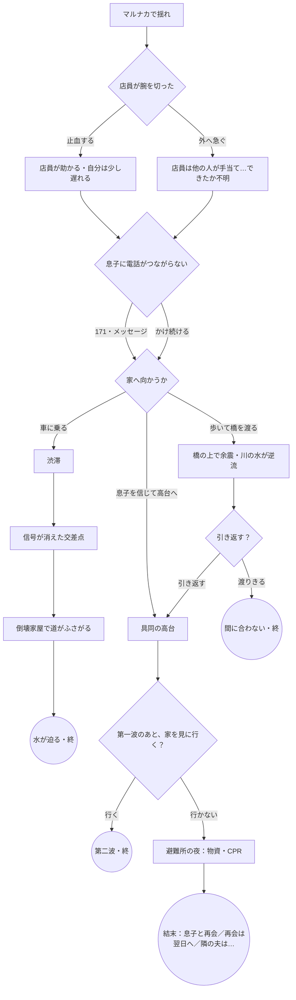

# その瞬間、あなたは ― 四万十 津波編（仮題）
## 設計案 v0.1（実装前の確認用）

> 四万十市の人たちへ。南海トラフ巨大地震と津波から生き延びる、選択肢で進む物語ゲーム。
> この文書は、実装に入る前に確認していただくための設計案です。
> **【要確認】** と書いた所は、決めていただくか、地元の方や公表資料で確かめていただきたい所です。

---

## 0. 先に決めていただきたいこと（10項目）

| # | 項目 | 私の提案 | 理由 |
|---|---|---|---|
| Q1 | 地震が起きる日時 | **10月の平日、午前10時40分** | 授業中・外来の待ち時間・スーパーで買い物・加工場で作業・沖でサーフィン、が全部そろう時間帯。昼の明るい画面から始めて、夜の避難所へつなげられる |
| Q2 | 少女がいる「大規模公園」 | **平野の海岸近くにある架空の海浜公園**（カフェも架空） | 土佐西南大規模公園は主に黒潮町にあるため。平野ならサーファーと交差できる。実在の公園を使いたい場合は名前を教えてください |
| Q3 | 実習生の国籍と職場 | **ベトナム出身。下田の架空の水産加工場（ちりめん・青さのりの加工）** | 幡多地域の実習生はベトナム・インドネシア出身が多い。下田は河口に近く津波が早い。ベトナム人の名前には性別を表す部分がある（女性はThị、男性はVăn）ので、名簿の名前と本人の名乗りのずれを自然に描ける |
| Q4 | 実習生の名前 | 在留カードの名前は **グエン・ティ・ラン**。本人は **「ミン」** と名乗っている | 「Thị」が女性の名前であることを、避難所の名簿の場面で使う |
| Q5 | 先生の学校を避難所にする件 | **先生の学校は低い土地にあり、浸水する**。翌日に開く避難所は、高台にある架空の学校の体育館（「○○台小学校」） | 学校そのものが避難所になると「校庭で待つと危ない」という教訓が成り立たない。先生は翌日からその避難所の運営を手伝い、そこで実習生・主婦・外来患者と出会う |
| Q6 | 防災無線の言葉 | **無線は標準語（ただし反響と雑音で途切れる）**。地元の人の声は幡多弁 | 実際の防災無線は標準語で放送されることが多いため。「標準語でも聞き取れない」体験と「幡多弁が分からない」体験は分けたほうがリアル。ご希望なら無線も幡多弁にします |
| Q7 | 主婦の家族 | 中村の家に **熱で学校を休んだ中学生の息子** がいる | 「迎えに行くか」の葛藤が強く、てんでんこ（家族を信じて自分も逃げる）を描ける。息子が隣のおじいさん（＝外来患者の夫）を助けると交差になる |
| Q8 | 入院患者の生まれ年 | **1946年生まれ（80歳）。昭和南海地震の年に生まれた** | 母親から聞いた昭和南海の話を持っている人にできる。地元の記憶を伝える役 |
| Q9 | 作品の題 | 「その瞬間、あなたは ― 四万十 津波編」（仮） | 救急版と同じシリーズに見える題にする |
| Q10 | 置き場所 | このリポジトリの `tsunami/index.html`（1つのHTMLファイル） | 救急版（`kyukyu/`）と並べる。GitHub Pagesでスマホから開ける |

---

## 1. 世界の設定（8つの物語で共通）

### 1-1. 共通の時間の流れ（「地震発生からの時間」）

画面の時計は「**地震発生から 0:12**」のように経過時間を出す（Q1の時刻は最初に1回だけ出す）。津波到達までの残り時間は出さない。

| 経過 | 起きること | 演出 |
|---|---|---|
| 0:00〜0:03 | 長い揺れ（約3分）。立っていられない。棚が倒れる | 揺れ（今の`quake`を長く・強弱つきに）、物が落ちる音 |
| 0:03ごろ | 大津波警報。防災無線・携帯の警報音 | サイレン、途切れる無線 |
| 0:03〜0:15 | 中村で家の倒壊・火災、けが人。道に瓦礫。停電。電話がつながらない | 煙、土ぼこり |
| 〜0:10前後 | 平野の海岸に津波（海岸線は早い所で5分未満に30cmの浸水）**【要確認】** | 海が引く／白い線が近づく |
| 0:10〜0:20 | 下田・初崎（河口近く）に津波 | 暗転、水位 |
| 0:30〜0:40 | 竹島・八束あたりへ川を遡る | 川の水が逆流する |
| 0:40以降 | 中村の市街地・具同へ。四万十川と後川から水が入る **【要確認：市街地の到達時間】** | 低い所から水が広がる |
| 1:00〜3:00 | 第二波・第三波。第一波より大きいこともある | 「引いた」後にまた来る |
| 夜 | 避難所の夜。寒さ・トイレ・眠れない・薬がない | 夜、ろうそく・ライト |
| 翌日以降 | 拠点避難所。臨時情報（後発地震への注意）、車中泊、災害関連死の危険 | 明るさが戻るが不安 |

### 1-2. 立地ごとの「主な敵」が違う

これが8本を遊ぶ意味になる。

- **海岸（平野）**：**時間**。揺れたら数分で動き出さないと間に合わない。
- **河口（下田・初崎）**：**時間＋言葉＋役目**。
- **中村の市街地・具同**：**倒壊と火災が先、津波が後**。昭和南海地震では中村の町は揺れと火事で大きな被害を受けた。時間がある分「迷う時間」「戻る時間」が罠になる。
- **病院**：**動けないこと**。時間はあるが、自分の足では逃げられない。

### 1-3. 地名の扱い

- 実在名を使う：四万十市、中村、具同、下田、初崎、平野、竹島、八束、四万十川、後川、為松公園、マルナカ（具同）、四万十市立市民病院、津波避難タワー（一般名として）
- 架空名にする：学校（中村の「○○小学校」、高台の「○○台小学校」）、水産加工場、カフェ、海浜公園（Q2）、個人宅・店、人物すべて
- 市民病院は名前だけ実在。建物の構造・避難計画・職員の動きは架空で、タイトル画面と病院の物語の冒頭に **「実際の避難計画とは関係ありません」** と出す

---

## 2. 立地ごとの難易度と根拠

### 2-1. 根拠にした公表値（2025年秋に高知県が出した新しい津波浸水予測。報道による）

- 四万十市の海岸沿いの最大津波高：**15〜20m、一部で20mを超える**
- 四万十川沿い（左岸の下田・鍋島など）：**5〜10m**
- 30cmの浸水が始まる時間：**海岸沿いの早い所で5分未満、下田・初崎で10〜20分、竹島小・八束小の周辺で30〜40分**
- 浸水面積：908.5ha（2012年推計）→ 932.5ha
- ~~国の資料では、四万十市内の多くの区域で5〜10mの浸水深が想定され…~~ **訂正**：これは四万十川の「洪水」のタイムライン資料で、津波の想定ではありませんでした。津波の実際の数字は §10 を見てください

**【要確認】中村の市街地・具同・市民病院の位置の「到達時間」と「浸水深」**。
高知県のサイト（pref.kochi.lg.jp）は、この作業環境のネットワーク設定で開けませんでした。四万十市の津波浸水予測図（市町村別図）で、次の数字を確認したいです。
- ①中村の市街地（学校の想定地）、②具同のマルナカ付近、③市民病院付近、④平野海岸、⑤平野・下田の津波避難タワーや高台の位置

開けるようにしたい場合は、この環境の「許可するホスト」に `www.pref.kochi.lg.jp` を加えると、私が直接読めるようになります。

### 2-2. 難易度（★1〜5）

| 主人公 | 場所 | 到達まで | 高台・タワーまで | 浸水深 | その他 | 難易度 |
|---|---|---|---|---|---|---|
| 2 サーファー | 平野の沖 | **最短（5分未満〜）** | 浜から陸へ上がってさらに移動 | 最大（15〜20m級） | 海上では揺れが分かりにくい | ★★★★★ |
| 6 消防団員 | 下田→海側の水門 | 10〜20分 | **海の方へ向かう**＝高台から遠ざかる | 5〜10m | 役目と命の板ばさみ | ★★★★★ |
| 3 実習生 | 下田の加工場 | 10〜20分 | 近くにタワー、遠くに山【要確認】 | 5〜10m | 日本語が分からない | ★★★★☆ |
| 1 少女 | 平野の公園カフェ | 海岸と同じく早い | 土地勘ゼロ | 大 | 方言が分からない。ただし周りに大人がいる | ★★★★☆ |
| 8 入院患者 | 市民病院（中村） | 40分以上？【要確認】 | 建物の上の階へ（垂直避難） | 【要確認】 | 自力で動けない。他人の手が必要 | ★★★★☆ |
| 4 先生 | 中村の小学校 | 40分以上？【要確認】 | 為松公園など高台まで子ども連れで徒歩 | 【要確認】 | 数十人を預かる。倒壊・火災が先 | ★★★☆☆ |
| 5 主婦 | 具同のマルナカ | 40分以上？【要確認】 | 具同の山側【要確認】 | 【要確認】 | 家族への思い。車の罠 | ★★★☆☆ |
| 7 外来患者 | 市民病院（中村） | 40分以上？【要確認】 | 病院の上の階 | 【要確認】 | 病院に残れば比較的安全。**帰ろうとすると★★★★** | ★★☆☆☆ |

「時間がある場所ほどやさしい」わけではない、というのが伝えたい点。中村組は時間がある分、「家に寄る」「迎えに行く」「様子を見る」という選択で危険を自分から増やしてしまう。難易度表の横に、この一言を入れる。

ゲーム内では難易度を「★」と短い理由（例：「海の上。津波が一番早く来る」）でメニューに出し、遊ぶ人が年齢と難しさで選べるようにする。

---

## 3. 8人のあらすじと、悩む選択肢

共通のルール
- 1つの物語は **選択8〜10回、10〜15分**
- 選択肢は「正解・まあまあ・まずい・その場で終わる」の4種類（救急版の best/ok/bad/fatal）。ただし **正解が一目で分からない書き方** にする。「助ける」「待つ」のどちらにも筋の通った理由をつける
- 選んだ結果は「この物語の後の場面」と「他の物語」の両方に響く（§5）

---

### 1. 少女　**七海（ななみ・10歳）** ― 「ことばの分からない町で」
**県外からの家族旅行。平野の海浜公園のカフェ。** 父は浜へ写真を撮りに、母と弟はトイレへ。七海は一人でジュースを待っていた。

**あらすじ**
揺れの最中、カフェのテーブルの下へ。揺れがおさまると、店の人が何か叫んでいるが、幡多弁で半分しか分からない（「はよう〇〇〇〇へ〇〇〇けん！」）。防災無線は反響して聞き取れない。家族を探したい。でも、知らないおばちゃんが手を引こうとする。途中で「海が引いている」のを見た人の声、サーファーのお兄さん（2）に出会う。高台で、家族と会えるかどうかは、家族が「はぐれたら高い所で会う」と決めていたか（序盤の会話の回想）と、七海自身の選択で変わる。

**悩む選択肢**
1. 揺れの後：**お母さんたちがいるトイレへ走る** ／ その場で待つ（「動いたら会えなくなる」）／ 店の人の後についていく
2. 知らない大人が「〇〇〇、おいで！」と手を引く：**ついていく** ／ 「知らない人について行っちゃだめ」と言われたことを守って断る ／ 名前を聞いてからにする
3. 無線の「…ナミ…ケイホウ…タカイ…」：「ナミ」を自分の名前（七海）と聞き違えて **放送のある建物へ向かう**（誤解の選択肢）／ 「タカイ」だけ信じて上へ
4. 浜の方に父の姿が見えた気がする：**浜へ走る** ／ 大声で呼ぶだけで、自分は上へ
5. 高台で：家族がいない。**探しに下りる** ／ 待つ ／ 大人に名前と「お母さんの電話番号」を伝える

**教訓**：稲むらの火（周りに知らせる）、奥尻（数分で来る）、東日本（子どもが自分で高台へ）、てんでんこ（家族と先に決めておく）

---

### 2. サーファー　**大地（だいち・20歳）** ― 「海の上では揺れない」
**平野サーフビーチ。沖で波を待っている。** 海の上では揺れがよく分からない。浜の様子がおかしい。

**あらすじ**
陸の方から変な音。浜で人が騒いでいる。携帯は車の中。ボードで戻るか、どのくらい速く上がれるか。浜に上がると、駐車場にはボードを積んだ車。車で逃げれば速い気がする。浜には知らない家族連れ、写真を撮っている男性（＝少女の父）。消防団員（6）が浜の方へ叫んでいる。

**悩む選択肢**
1. 沖で：**いい波が来るまで様子を見る** ／ すぐ戻る ／ 沖へ出る（「沖の方が安全」と聞いたことがある＝誤解。船ならともかく、ボードでは無理）
2. 浜で：**ボードを車に積む** ／ ボードも車も置いて走る
3. 車：**車で逃げる（一番速いはず）** ／ 走る。平野は道が少なく、渋滞に巻き込まれる展開
4. 浜の知らない人：**一人ひとりに声をかける（時間がかかる）** ／ 大声で一度叫んで自分は走る ／ 自分のことで精一杯
5. カフェの近くで泣いている女の子（1）：**手を引いて連れて行く** ／ 近くの大人に任せる
6. 高台で：第一波が小さかった。**車を取りに戻る** ／ 戻らない

**教訓**：奥尻（数分で来る）、稲むらの火（周りに知らせる）、東日本（車での避難、第一波の後に戻る）

---

### 3. 技能実習生　**ミン（30歳）** ― 二部構成「にげる」「ひなんじょ」
**ベトナム出身。下田の水産加工場で3年目。出生時の性別は女性、心は男性。** 日本語は「はい」「すみません」「だいじょうぶ」程度。幡多弁はさらに分からない。仕事場では作業着で、髪は短い。寮の部屋にはパスポートと在留カード、家族の写真。

**表現の方針**
- 序盤の台詞は、ミンに聞こえる通りに出す：「〇〇〇〇〇〇！ 〇〇、〇〇〇〇〇！」→ 聞き取れた単語だけが残る（「つなみ」「にげ」「やま」）。物語が進むにつれて、覚えた単語が増えていく（例：「たかい」を一度覚えると、その後の台詞で「たかい」が見えるようになる）
- ミンの心の声はベトナム語の気持ちとして**ふつうの日本語**で書く（遊ぶ人はミンの考えは分かるが、周りの言葉は分からない）
- 笑いの対象にも、かわいそうな人にもしない。ミンは判断し、選び、助けも求める

**第一部「にげる」**
揺れで加工場のラインが止まる。日本人の先輩たちが叫んで走り出す。同じ部屋の後輩ベトナム人（女性）が泣いている。寮はすぐ近く。津波避難タワーは近いが、本当に高さは足りるのか。山は遠い。

**悩む選択肢（第一部）**
1. 揺れの後：**寮にパスポートと在留カードを取りに戻る**（失うと国に帰れない、と思い込んでいる）／ 取りに行かない
2. 先輩が手招きして何か叫ぶ：**ついていく** ／ 後輩を探してから ／ 「わからない」と伝える（スマホの翻訳を使う、時間がかかる）
3. タワーか山か：**近いタワー** ／ 遠い山（先輩が「タワーよりやまへ」と言った？ 聞き取れない）
4. 途中で道に座り込むおばあさん：**背負う** ／ 人を呼ぶ ／ 先に行く
5. 高台で、第一波の後：**寮へ戻る** ／ 戻らない

**第二部「ひなんじょ」（翌日〜、高台の○○台小学校の体育館）**
避難所の受付で名簿に書く。先生（4）や主婦（5）が運営を手伝っている。

**悩む選択肢（第二部）**
1. 名簿：在留カード通りの名前と「女」に丸をつける ／ **「ミン」とだけ書き、性別を空けておく** ／ 何も書かずに外にいる
2. 呼ばれ方：「グエン・ティ・ランさーん」と大声で呼ばれる。**返事をする** ／ 返事をしない ／ あとで受付の人にだけ、翻訳アプリで「ミンと呼んでほしい」と伝える
3. トイレ：女性用の列 ／ 男性用の列 ／ **誰もいない時間まで我慢する**（水を飲まなくなる → 脱水・エコノミークラス症候群の危険）／ 多目的トイレがあるか聞く
4. 寝る場所：「女性・子どもスペース」に案内される。**従う** ／ 体育館の入口近くで一人で寝る ／ 運営の人に相談する
5. 物資：生理用品が手渡される。必要なのは確かだが、人前で受け取るのはつらい。**受け取らない** ／ 受け取る ／ 後で、人のいない所で取れる場所があるか聞く
6. 夜、隣の家族の子どもが熱を出す。ミンは前職で看護助手の経験がある（設定案）：**手伝いを申し出る**（言葉が通じない中で）／ 黙っている

**周りの人の物語**（交差：§5）
- 先生（4）の物語では「名簿の性別欄を必須にするか」「呼び出しを名前の大声でするか番号にするか」「多目的トイレ・更衣の場所をどう作るか」を選ぶ
- 主婦（5）の物語では「生理用品を、手渡しではなく人目のない棚に置く」かを選ぶ
- どちらかで配慮を選んでいると、ミンの物語で選べる選択肢が増える（「番号で呼ばれた」「棚から自分で取れた」）

**教訓**：東日本（第一波後に戻る、避難所での女性や性的少数者への配慮不足）、能登（避難所のトイレ）、熊本（関連死）、外国人への「やさしい日本語」

---

### 4. 小学校の先生　**岡村（おかむら）先生（40歳）** ― 「校庭の1分」
**中村の架空の小学校。4年生の担任、27人。授業は算数。** 学校は低い土地。前から「避難場所は校庭」「その次は為松公園方面の高台」と決まっているが、高台へ移る判断は誰がするのか。

**あらすじ**
揺れの間、机の下へ。窓ガラスが割れる。揺れの後、校庭へ。点呼をとる。教頭は「指示があるまで待機」。迎えに来た保護者が「うちの子を連れて帰る」。ある子が「先生、こっちの方が高いよ、お兄ちゃんが言いよった」。高台へ移ったあと、決められた避難場所でさらに上へ行くか。翌日から高台の避難所の運営を手伝う（第二の顔）。

**悩む選択肢**
1. 揺れの後：**教室で全員の安全を確かめる** ／ すぐ校庭へ（ガラスと倒れた棚）／ 階段で転んで足をくじいた子がいる（**骨折の固定**）
2. 校庭で：「指示を待て」と教頭。**待つ** ／ 自分のクラスだけでも高台へ ／ 教頭を説得する（時間がかかるが全校が動く）
3. 保護者が迎えに来た：**引き渡す**（家の方は低い）／ 「一緒に高台へ」と誘う ／ 渡さない（保護者は怒る）
4. 「こっちの方が高いよ」：**子どもの声を信じて道を変える** ／ 決められた道を行く（倒壊家屋でふさがっている）
5. 決められた避難場所に着いた：「ここは浸水想定の外だから大丈夫」と言われる。**ここで止まる** ／ さらに上へ
6. （翌日・避難所の運営）名簿の性別欄、呼び出し方、トイレの数と場所（能登）、女性と性的少数者のための更衣・物干し場所

**教訓**：東日本（校庭での待機、子どもたちが自ら高台へ、想定にとらわれない）、阪神（机の下、家具の転倒）、能登（避難所のトイレ）、東日本（避難所の配慮不足）

---

### 5. 主婦　**山下 恵子（50歳）** ― 「赤い鉄橋の向こう」
**具同のマルナカで買い物中。** 中村の家には熱で学校を休んだ中学2年の息子・翔太。夫は宿毛へ仕事。

**あらすじ**
揺れで棚が倒れ、ガラスの割れた冷蔵ケースで店員が腕を深く切る（**止血**）。息子に電話がつながらない。家は橋を渡った向こう。駐車場には自分の車。店の人は「みんな山の方へ」。息子は一人で逃げているだろうか。

**悩む選択肢**
1. 店内で：**けがをした店員の止血をする** ／ すぐ外へ（止血は他の人に任せる）
2. 電話がつながらない：**何度もかけ直す** ／ 災害用伝言ダイヤル171・SNSで「為松公園に行け」とだけ送る ／ 前から決めていた場所を思い出す（「地震の時は為松公園」と決めていたか＝序盤の会話の選択）
3. **車で家へ向かう**（＝この時点で死亡ルート確定。すぐには死なせない：駐車場を出る車の列 → 停電で信号が消えた交差点で止まる → 橋の手前の倒壊家屋で道がふさがる → 戻れない、降りようとする → 水が来る。暗転。解説へ）
4. 歩いて橋を渡り家へ ／ 渡らずに店の人と具同の高台へ ／ 息子を信じて自分も逃げる（てんでんこ）
5. 息子に送るメッセージ：「お隣のおじいちゃんにも声をかけて」と書くか（→ 外来患者（7）の夫が助かるかどうか）
6. （避難所）生理用品・下着などの物資をどう配るか（実習生と交差）、倒れた人に**心肺蘇生とAED**（ミニゲーム流用）

**教訓**：東日本（車での避難の渋滞、てんでんこ）、阪神（倒壊家屋で道がふさがる）、熊本（車中泊）、東日本（避難所の配慮）

---

### 6. 消防団員　**浜田 繁（はまだ・しげる・60歳）** ― 「閉めに行くか」
**下田の分団。ふだんは漁師。** 地震の時は河口近くの水門と陸閘を閉めに行く役目がある。自宅には妻。

**あらすじ**
揺れの後、法被を着て軽トラで水門へ。途中で逃げ遅れた住民。平野の浜に人が残っているのが見える（サーファーと交差）。分団の決まりでは、到達予想時刻の何分前には退避する、と決めている（今の「退避ルール」）が、まだ閉まっていない水門がある。夜、道路が寸断され下田が孤立する。翌朝、倒壊した家の下にいた人を救出する（**クラッシュ症候群**）。

**悩む選択肢**
1. 揺れの後：**水門へ向かう** ／ 妻と一緒に逃げる ／ 妻を先に逃がしてから水門へ
2. 水門の1つ目を閉めた。退避時刻が近い。2つ目は遠い：**2つ目へ行く** ／ 退避する
3. 浜に人：**浜へ下りて声をかける** ／ 拡声器で叫ぶだけ ／ 見なかったことにする
4. 腰の悪い住民が「わしは家におる」：**無理にでも連れて行く** ／ 説得を続ける ／ 置いていく（あとで仲間に伝える）
5. 高台で、まだ水門の方に仲間がいる：**迎えに行く** ／ 無線で退避を呼びかける
6. 翌朝の救出：18時間挟まれていた人。助け出した後、**元気そうなので避難所へ** ／ 挟まれていた時間を伝えて医療につなぐ（救急版CASE10の発展）
7. 停電復旧前に：家々のブレーカーを落として回るよう呼びかけるか（通電火災）

**教訓**：東日本（消防団員の犠牲、今の退避ルール）、能登（孤立、高齢化）、阪神（近所の人による救出、クラッシュ症候群、通電火災）、稲むらの火

---

### 7. 市民病院の外来患者　**川村 すみ子（70歳）** ― 「お父さんが家におる」
**高血圧と糖尿病で通院。内科の順番待ち。** 中村の家には足の悪い夫・正男（78）。

**あらすじ**
待合で揺れ。天井の板が落ちる。職員が「上の階へ」と誘導する。夫に電話がつながらない。家までは歩いて15分。階段で、車いすの入院患者（8）とすれ違う。避難所では持病の薬が手元にない。娘が車で迎えに来て、車中泊をすすめる。

**悩む選択肢**
1. 揺れの後：**家へ帰る**（夫が一人）／ 病院に残る ／ 職員に事情を話して判断を仰ぐ
2. 電話がつながらない：**何度もかける** ／ 171に録音 ／ 隣の家（主婦の家）にかける
3. 階段で車いすの入院患者：**手を貸す**（自分も遅れる）／ 職員を呼ぶ ／ 先に上がる
4. （夜）第一波の後、水が引いた：**家を見に帰る** ／ 残る
5. （避難所）薬がない：**我慢する** ／ 救護所で「お薬手帳」なしでも名前を伝える（スマホの写真、薬の袋）
6. （翌日）車中泊：**車で寝る**（人目がない・夫を休ませたい）／ 体育館で寝る ／ 車で寝るが、水を飲み、足を動かす
7. （数日後）家に戻る時：ブレーカーを落としてから電気を戻すか（通電火災）、「臨時情報」が出ている中で戻るか（熊本：あとからもっと大きな揺れ）

夫が助かるかどうかは、主婦（5）の物語の選択で変わる（§5）。主婦の物語をまだ遊んでいない場合は、夫は「近所の人に助けられた」「見つからない」のどちらかになる（すみ子の選択による）。

**教訓**：東日本（第一波の後に戻る）、熊本（あとから大きな揺れ、車中泊、エコノミークラス症候群、関連死）、阪神（通電火災）

---

### 8. 市民病院の入院患者　**西村 源一（80歳）** ― 「わしはもうええけん」
**肺炎で入院して2週間。足が弱って歩行器がやっと。** 1946年、昭和南海地震の年に生まれた。母から「中村の町がみなつぶれて、燃えた」と聞かされて育った。同じ部屋に、酸素をつけた寝たきりの人。

**あらすじ**
ベッドで揺れ。看護師が来るまで時間がかかる。看護師は一人で何人も見ている。上の階へ移る順番。「わしはもうええけん、先に行ってくれ」と言うか。同じ部屋の人を先に、と言うか。階段で外来患者（7）とすれ違う。その夜、上の階の廊下で、源一は母から聞いた昭和南海の話を若い看護師にする。

**悩む選択肢**
1. 揺れの後：**ナースコールを押し続ける** ／ 自分でベッドを降りて歩こうとする（転倒の危険）／ 布団をかぶって待つ
2. 看護師が来た：「**わしはもうええけん、先に行ってくれ**」と言う ／ 素直に助けを受ける ／ 「隣の人を先に」と言う
3. 運ぶ人が足りない：外来の人が手を貸そうとする。**断る**（迷惑をかけたくない）／ 頼む
4. 上の階で：同じ部屋の人の酸素が切れそう。**大声で職員を呼ぶ** ／ 遠慮して黙る
5. 夜：「昔もこの町はつぶれた。またこうなるがか」と気持ちが沈む。**語る**（看護師に昭和南海の話）／ 黙って横になる
6. 翌日：食事も水も「トイレが大変だから」と減らす。**我慢する** ／ 正直に言う（関連死の予防）

**教訓**：昭和南海（中村の町の記憶）、能登（高齢化した地域）、熊本（関連死）、「助けを受けることも、生き延びる判断」

---

## 4. 教訓と場面の対応表

| 災害 | 教訓 | 主に入れる主人公と場面 | 解説で伝えること（確認できた事実） |
|---|---|---|---|
| 昭和南海地震（1946） | 中村の町の被害 | 8 源一の回想・夜の語り。中村の場面すべての冒頭 | 旧中村町では約2300戸のうち1600戸あまりが全壊し、火災も起き、死者は約270人（資料により273人・277人）。県内で最も多かった。四万十川の鉄橋も落ちた。中村の地盤は川がつくった低い土地 |
| 安政南海地震（1854）「稲むらの火」 | 揺れたら高台へ、周りに知らせる | 2 大地（浜で声をかける）、6 浜田、1 七海（大人に知らせる） | 紀伊国広村（今の和歌山県広川町）で、浜口梧陵が稲むらに火をつけて村人を高台に導いたと伝わる話 |
| 阪神・淡路大震災（1995） | 家屋倒壊・家具の下敷き | 4 教室、5 道の倒壊家屋、7 待合 | 倒壊した建物から救出された人の多くは自力・家族・近所の人によるもので、救助隊による救出は約1.7%という調査がある |
| 〃 | 近所の人による救出、クラッシュ症候群 | 6 浜田（翌朝の救出） | 長時間挟まれていた人は、救出後に急に悪くなることがある。「何時から何時まで、どこを挟まれていたか」を伝える |
| 〃 | 通電火災 | 6 浜田、7 すみ子（帰宅時） | 停電から電気が戻った時に火災が起きることがある。避難する時・家に戻る時はブレーカーを落とす【件数は確認中】 |
| 北海道南西沖地震（1993・奥尻島） | 数分で津波が来ることがある | 2 大地、1 七海 | 地震から4〜5分で津波が来た。死者202人・行方不明28人 |
| 東日本大震災（2011） | 津波てんでんこ | 5 恵子（息子）、7 すみ子（夫）、1 七海（家族） | 自分の命を自分で守ることが、結果として家族の命も守る。家族で前もって集合場所を決めておく |
| 〃 | 想定にとらわれない | 4 先生（避難場所に着いてからさらに上へ） | ハザードマップの外でも浸水した場所がある |
| 〃 | 校庭での待機 | 4 先生（架空の出来事として） | 特定の学校を思わせないよう架空の学校・架空の経過で描く。解説は一般的な教訓として書く |
| 〃 | 子どもたちが自ら高台へ | 4 先生（「こっちが高いよ」）、1 七海 | 日頃の防災教育で、子どもたちが自分で判断して高台へ逃げた例がある |
| 〃 | 車での避難と渋滞 | 5 恵子（死亡ルート）、2 大地 | 徒歩が原則。車は渋滞・信号停止・道路の寸断で動けなくなる |
| 〃 | 水門を閉めに向かった消防団員の犠牲 | 6 浜田 | 消防団員の死者・行方不明者は254人（うち公務中198人）。その後、津波到達までの時間が短い地域では退避を優先する考え方が示された |
| 〃 | 第一波の後に戻った人の犠牲 | 2 大地、3 ミン、7 すみ子 | 第二波・第三波の方が大きいことがある。警報が解除されるまで戻らない |
| 〃 | 避難所での女性・性的少数者への配慮不足 | 3 ミン第二部、4 先生、5 恵子 | 更衣・授乳・物干し・物資の配り方・トイレ・呼び方・名簿の性別欄 |
| 熊本地震（2016） | 大きな揺れの後に、さらに大きな揺れ | 7 すみ子（臨時情報）、8 源一 | 4月14日に震度7、その2日後の16日にさらに大きな地震（震度7）。南海トラフでも「臨時情報」が出ることがある |
| 〃 | 車中泊とエコノミークラス症候群、災害関連死 | 7 すみ子、3 ミン（水を我慢）、8 源一 | 直接の死者50人に対し、関連死は200人を超えた（内閣府資料では関連死215人、2019年時点） |
| 能登半島地震（2024） | 津波到達の早さ | 2 大地、1 七海 | 【数字は確認中】 |
| 〃 | 道路の寸断と孤立、高齢化した地域 | 6 浜田（下田の孤立）、8 源一 | 【数字は確認中】 |
| 〃 | 避難所のトイレ | 4 先生、3 ミン、8 源一 | 【数字は確認中】 |

実在の悲劇（特定の学校、特定の地区の消防団など）は、物語の中では架空の出来事として作り直し、地名や人数を似せない。解説では「東日本大震災では〜という教訓があります」と一般的に書く。

---

## 5. 分岐の構造と、物語どうしの交差

### 5-1. 1本の物語の形（例：主婦）

- 「終」の結末（命を落とす）は、救急版の「取り返しのつかない判断」画面を流用し、**その場面の直前からやり直せる**
- 生き延びた場合も、救えた人・救えなかった人で結末が3〜4通りに分かれる
- S〜Cランクは「生き延びたか」だけでなく「周りに知らせた・助けた・正しく伝えた」で決まる

### 5-2. 交差ポイント

| # | 時間 | 場所 | 物語A | 物語B | 何が響くか |
|---|---|---|---|---|---|
| X1 | 0:05ごろ | 平野の浜 | 2 大地 | 6 浜田 | 浜田が浜へ下りて叫ぶ／拡声器だけ → 大地の物語で浜田の声が「聞こえる・遠い」 |
| X2 | 0:06ごろ | 平野の公園 | 2 大地 | 1 七海 | 大地が女の子の手を引くか → 七海の物語に「サーファーのお兄さん」が現れるか |
| X3 | 0:07ごろ | 平野の浜 | 2 大地 | 1 七海の父 | 大地が写真を撮っている男性に声をかけるか → 七海が父と会えるか |
| X4 | 0:20ごろ | 市民病院の階段 | 7 すみ子 | 8 源一 | すみ子が手を貸すか／源一が頼むか → 両方の物語で「すれ違い」の場面が変わる |
| X5 | 0:10ごろ | 中村の家（隣どうし） | 5 恵子の息子 | 7 すみ子の夫 | 恵子が「お隣にも声を」と送るか → すみ子の夫の運命 |
| X6 | 翌日 | ○○台小学校の避難所 | 4 先生 | 3 ミン | 先生が名簿・呼び方・トイレで配慮を選ぶか → ミンの選べる行動が増える |
| X7 | 翌日 | 同上 | 5 恵子 | 3 ミン | 物資の置き方 → ミンの物資の場面 |
| X8 | 夜 | 同上 | 3 ミン | 5 恵子・7 すみ子 | ミンが子どもの看病を申し出るか → 恵子／すみ子の物語に「言葉の通じない青年」の場面 |
| X9 | 翌朝 | 下田 | 6 浜田 | 3 ミン | ミンが背負ったおばあさん → 浜田の物語で「あのおばあさんは無事だった」 |

### 5-3. 交差の仕組み（「アツい」ところ）

- それぞれの物語は、どれから遊んでも1本で完結する
- 物語を終えると、その中の大事な選択が **「みんなの記録」** として端末に残る（救急版のランク保存と同じ仕組み）
- 別の物語で交差点に来た時、記録があれば **「あの時の、あの人だ」** と分かる演出が入り、展開が変わる。例：大地の物語でカフェの女の子を連れて行っていれば、七海の物語に大地が現れる
- まだ遊んでいない物語との交差点は、「もう一人の物語」として、メニューに **「?」** で表示（交差の数が見える）
- **8本すべてを終えると「その夜」（エピローグ）が開く**：避難所の体育館に、8人それぞれの「その後」が集まる。誰が生き延びたかは、あなたの選択の記録どおりになる
- **全員が生き延び、交差点で手を差し伸べ合った時だけの結末** がある（難しいが、必ずたどり着ける）

---

## 6. 救急版から流用する部分と、新しく作る部分

### 流用する（ほぼそのまま）
- 画面の仕組み：タイトル → メニュー → 物語 → 結末 → 解説。`show()`、`.screen`
- 物語データの形：`cast`・`nodes`・`lines`・`choices`（`g`/`dt`/`sc`/`flag`/`res`/`why`/`next`）・`outcome(S)`・`debrief`・`deep`
- 行の処理：`play`/`step`/`doAction`/`say`（文字送り・タップ）
- SVGのキャラ：`fig()`・`LOOK`・`DIM`・ポーズ（stand/sit/down）・表情・感情マーク
- 演出：`quake`/`shake`/`flash`/`siren`/`smoke`/`night`/`dim`/`red`
- 選択肢シート・観察チップ（`obs`）・制限時間バー（`timer`）
- 結末のランクS〜C、「取り返しのつかない判断」画面とやり直し、解説の「あなたの選択 → より良い判断」一覧
- 心肺蘇生ミニゲーム（`runCPR`）
- 効果音とBGMの合成（`sfx`/`music`、外部ファイルなし）
- 記録の保存（`REC`）、ネタバレ表示の切り替え

### 手直しする
- 時計：「時刻」から「**地震発生からの経過**」へ。日付表示は「翌日」「3日目」に
- 揺れ：数分続く長い揺れ（強弱の波、物が落ちる、途中でタップしても終わらない）
- 色調：救急版の明るい画面を基本に、**「緊迫モード」**（暗い青灰色、画面の縁が暗くなる、BGMが低く）と **「夜モード」**（避難所）を切り替える
- メニュー：17症例の一覧 → **8人の主人公カード**（年齢・場所・★難易度・交差の数）
- キャラ：新しい見た目を追加（10歳の少女、サーファー（既存を調整）、作業着のミン、先生、主婦、法被の団員、外来の高齢女性、病衣の高齢男性、看護師、子どもたち）

### 新しく作る
1. **舞台SVG**：平野の浜と海、海浜公園のカフェ、下田の加工場と漁港、津波避難タワー、中村の教室・校庭・町並み（倒壊・火災）、具同のスーパー、赤鉄橋（四万十川橋）、為松公園方面の高台、市民病院の待合・病棟・階段、避難所の体育館（昼・夜）、車の渋滞
2. **水の演出**：海が引く、白い線が近づく、川が逆流する、低い所から水が広がる（残酷な描写はしない。暗転と音で伝える）
3. **防災無線**：反響（同じ言葉が遅れて重なる）・雑音・途切れ
4. **「分からない言葉」の表示**：台詞の一部を伏せ字（〇）や崩れた文字にする仕組み。ミンの物語では「覚えた単語」が増えると見える文字が増える。解説で本当の台詞と標準語訳を明かす
5. **ふりがなの切り替え**：本文に `{漢字|かんじ}` の印をつけ、`<ruby>` で表示。設定で ON/OFF。**文字の大きさ** も3段階
6. **物語どうしの記録**（交差フラグ）と、交差の演出、エピローグ「その夜」
7. **二部構成**（ミン）：第一部の結末から第二部へ続く。第二部だけ遊ぶこともできる
8. 結末ごとの **「正しい避難行動」と「元になった災害の教訓」** の表示（救急版の解説を拡張）
9. 解説の最後に **「聞き取れなかった言葉」**（幡多弁の原文・標準語訳）
10. **出典一覧** の画面、**作者からのメッセージ** の画面（1画面、文章をあとから差し替えやすく）
11. 「この物語は架空です。実際の避難計画とは関係ありません」の表示（タイトル・病院の物語）

### 配る時のこと
- 1つのHTMLファイル。インストール不要
- 救急版はGoogle Fontsを読み込んでいる。**ネットがない場所（体育館など）でも文字がきれいに出るよう、端末の標準フォントで崩れないようにしておく**
- 音は合成なので、ファイルは軽い（目標：1MB前後）
- 学校や自主防災会で使いやすいよう、**物語ごとの「話し合いのヒント」**（例：「あなたなら保護者に子どもを渡しますか？」）を解説の最後に入れる案

---

## 7. 言葉（幡多弁）について

- 地元の人の台詞は幡多弁。高知市周辺の土佐弁の言い回し（「〜き」「〜ぜよ」「〜ちゅう」など）は混ぜない
- 私の幡多弁の知識は確かではありません。**実装時にすべての幡多弁の台詞に印をつけた一覧を出します**（場面・話している人・幡多弁・標準語の意味・自信の度合い）
- 今の時点での例（すべて【要確認】）：

| 自信 | 幡多弁（案） | 標準語 | 気になる点 |
|---|---|---|---|
| △ | はよう高い所へ逃げんといかんけん！ | 早く高い所へ逃げないといけないから！ | 「けん」は幡多で使うと理解しているが、言い方の自然さ |
| △ | 津波が来よるぞ！ | 津波が来ているぞ！ | 「〜よる」（進行）。「来ゆう」（土佐弁）との違い |
| △ | わしはもうええけん、先に行ってくれ | 私はもういいから、先に行ってくれ | ご指定の台詞。語尾の自然さ |
| △ | 何しよるがな、はよ上がらんか！ | 何をしているんだ、早く上がらないか！ | 「がな」は使うか |
| ? | おまん、どこの子ぞ？ | あなた、どこの子なの？ | 「おまん」は土佐弁寄りかもしれない。幡多では？ |
| ? | まっこと、えらいことになったのう | 本当に、大変なことになったなあ | 「まっこと」は土佐弁寄りかもしれない |
| ? | 昔もこの町はみなつぶれたがじゃ | 昔もこの町はみんなつぶれたんだ | 「〜がじゃ」は幡多で自然か |

---

## 8. 実装の順番（段階的な計画）

各段階の終わりに、スマホで遊べる形でお見せして、確認をいただいてから次へ進みます。

| 段階 | 内容 | 確認していただくこと |
|---|---|---|
| **0** | この設計案への回答（§0のQ1〜Q10、難易度、あらすじの直し） | ― |
| **1. 土台** | 救急版を写して `tsunami/` を作る。経過時計、長い揺れ、緊迫モード・夜モード、ふりがな切り替え、文字の大きさ、主人公メニュー、交差の記録の仕組み、免責表示。舞台は仮の絵 | 画面の雰囲気、文字の大きさ、ふりがなの見え方 |
| **2. 1本目：先生** | 中核になる物語。校庭・保護者・子どもの声・想定外・翌日の避難所運営。骨折の固定 | 選択肢の悩ましさ、長さ（10〜15分）、医学的内容 |
| **3. 2本目：ミン（二部）** | 「分からない言葉」の表示、防災無線の演出、避難所の場面。先生との交差（X6） | 描き方（性自認・外国人）の適切さ。可能なら当事者や支援団体の方にも見ていただきたい |
| **4. 海側3本：大地・七海・浜田** | 海の演出、水の演出、平野の舞台。交差 X1〜X3、X9。クラッシュ症候群 | 子どもが遊んで怖すぎないか |
| **5. 中村3本：恵子・すみ子・源一** | 車の死亡ルート、病院の舞台、昭和南海の語り。交差 X4・X5・X7・X8。止血・CPR・薬・車中泊 | 医学的内容、病院の描写 |
| **6. 仕上げ** | エピローグ「その夜」、全員生存ルート、解説・聞き取れなかった言葉・出典一覧・作者メッセージ、話し合いのヒント | 全体の通し確認 |
| **7. 言葉の確認** | 幡多弁一覧を地元の方に確認していただき、直す | 幡多弁 |
| **8. 配布版** | 古いスマホでの動作確認、オフラインでの表示確認、配布用の短い説明（学校・自主防災会向け） | ― |

1つの物語は、およそ選択8〜10回・場面15〜25枚の分量になる見込みです。

---

## 9. 出典（設計時点で確認したもの）

- 高知新聞「【高知県版津波浸水予測】四万十市 浸水想定面積が微増」 https://www.kochinews.co.jp/article/detail/922717 （検索結果の要約で確認。本文はこの環境から開けず【要確認】）
- 高知県「令和7年度［高知県版］南海トラフ地震による最大クラスの震度分布・津波浸水予測について」 https://www.pref.kochi.lg.jp/doc/2025100100137/ （この環境から開けず【要確認】）
- 高知県 四万十市の津波浸水想定図（平成24年） https://www.pref.kochi.lg.jp/doc/2019102100196/file_contents/240926_shimanto_max.pdf （【要確認】）
- 国土交通省 中村河川国道事務所 タイムライン資料 https://www.skr.mlit.go.jp/nakamura/2016newimg/20181126_siryou3.pdf
- 石橋克彦「1946年昭和南海地震」（『南海トラフ巨大地震―歴史・科学・社会』岩波書店、2014）抜粋 https://plaza.umin.ac.jp/GHDNet/circle/14/y9051.pdf
- 高知新聞「中村火災の記録詳細 大地震の記―資料が語る記憶」 https://www.kochinews.co.jp/article/detail/845097
- 内閣府 平成26年版防災白書「大規模広域災害時の自助・共助の例」 https://www.bousai.go.jp/kaigirep/hakusho/h26/honbun/0b_2s_01_00.html
- 総務省消防庁 e-カレッジ（阪神・淡路大震災の救出の割合） https://www.fdma.go.jp/relocation/e-college/cat66/cat62/cat55/2-25.html
- 総務省消防庁「東日本大震災を踏まえた大規模災害時における消防団活動のあり方等に関する検討会 報告書」（2012年8月） https://www.fdma.go.jp/pressrelease/houdou/items/h24/2408/240830_1houdou/01_houkokusyo.pdf
- 地震調査研究推進本部「北海道南西沖の地震活動」 https://jishin.go.jp/regional_seismicity/rs_kaiko/k14_hokkaidonanseioki
- 内閣府 防災情報「北海道南西沖地震」 https://www.bousai.go.jp/kyoiku/kyokun/hokkaidonaiseioki/dbindex/idx030201.htm
- 内閣府「熊本地震の被害の状況」資料（2019年） https://www.bousai.go.jp/taisaku/kyuujo/pdf/r01kaigi/siryo8.pdf

確認中（実装の段階で調べて追加）：能登半島地震（津波到達時間、孤立集落、避難所のトイレ）、阪神・淡路の通電火災の割合、稲むらの火（広川町の資料）、東日本大震災の避難所での女性・性的少数者への配慮（内閣府男女共同参画局の指針）、四万十市の避難場所・津波避難タワーの位置、市民病院付近の浸水深。

---

## 10. 調査結果（2026年11月16日、県と市の公表資料を直接確認）

### 10-1. 使った資料
- 高知県「令和7年度［高知県版］南海トラフ地震による最大クラスの震度分布・津波浸水予測」の四万十市の図（6-3 津波浸水予測時間図〈浸水深30cm〉、6-4 津波浸水予測図）と、黒潮町（大方）の図 https://www.pref.kochi.lg.jp/doc/2025100100137/
- 四万十市「津波避難マップ」平野地区・下田地区（2021年12月更新。到達時間は以前の想定による） https://www.city.shimanto.lg.jp/soshiki/2/1435.html
- 四万十市「指定緊急避難場所・指定避難所一覧」（2026年8月20日更新） https://www.city.shimanto.lg.jp/soshiki/2/27435.html
- 四万十市「防災情報伝達手段」（防災行政無線の聞き返し電話 0880-34-7800） https://www.city.shimanto.lg.jp/soshiki/2/1465.html

### 10-2. 地点ごとの数字（最大クラス・県R7予測の図を読み取ったもの）

| 地点 | 30cm到達 | 最大浸水深 | 近くの避難場所（市の一覧・マップ） |
|---|---|---|---|
| 平野の浜（平野海水浴場） | 海岸線は5分未満〜。市マップでは平野地区①②15分・③31分 | 浜は15〜20m | 県立土佐西南大規模公園（平野地区・標高30.7m）、平野集会所（35.3m）、若宮前広場など。消防団「下田分団 平野格納庫」が集落内にある |
| 下田（下田港・県道沿い） | 市マップでは下田地区①②18分。県R7では10〜30分 | 川沿い・港沿いは5〜10m、集落内は3〜5m | 有隣公園（28.5m）、下田中学校（旧、30.6m）、光明寺・秋葉神社・南宗寺・和霊神社、中医学研究所（旧、41.3m）、とまろっと（31.2m）、四万十いやしの里。下田小学校は3〜5mの浸水域の中。消防団「下田分団 下田屯所」（標高2.8m）も浸水域の中 |
| 竹島・八束 | 30〜40分 | 1〜5m | ― |
| 古津賀 | 30〜60分 | 1〜5m | 幡多農業高校、中村特別支援学校 |
| 中村の市街地（中村小・市役所・天神橋あたり） | **浸水域の外** | ― | 中村小学校（中村新町3丁目）は津波の指定緊急避難場所（使用可） |
| 中村東町（市民病院・中村中学校のあたり） | **浸水域の外**（後川との合流点の一部を除く） | ― | 中村中学校は津波の指定緊急避難場所（使用可） |
| 右山五月町・不破の一部 | 60分以上 | 0.3〜1m | 総合文化センター（しまんとぴあ）は2階以上 |
| 具同（マルナカの周辺） | **浸水域の外**。西の国見・東中筋側の田は60分以上・0.3〜2m | ― | 具同小学校（校舎3階以上）、中村西中学校 |
| 黒潮町 入野の海岸（土佐入野駅・土佐西南大規模公園の大方地区） | 海岸線5分未満〜、内陸は10〜30分 | 5〜15m | （黒潮町の資料は未確認） |

### 10-3. 分かったことと、設計への影響
1. **中村の市街地・具同・市民病院・中村小は、県の最新予測では津波の浸水域の外**。中村の物語で一番の敵は、揺れ・倒壊・火災（昭和南海地震と同じ）。津波は「来ない」のではなく「想定ではここまで来ない」で、解説でははっきり「想定にとらわれず」を伝える
2. **海側（平野・下田）は15〜18分で30cm、浸水深は5〜20m**。ここが津波との時間の勝負
3. 四万十市の平野・下田の地図に **津波避難タワーは見当たらない**。避難先は高台（公園・神社・旧中学校など）
4. 防災無線は、聞き取れなかった時に **0880-34-7800** で聞き返せる（実在の仕組みとして物語と解説に入れられる）
5. SUNLIFE COFFEE WAVES. は検索の範囲では **黒潮町入野** にある店（四万十市ではない）【店舗所在地は要確認】
